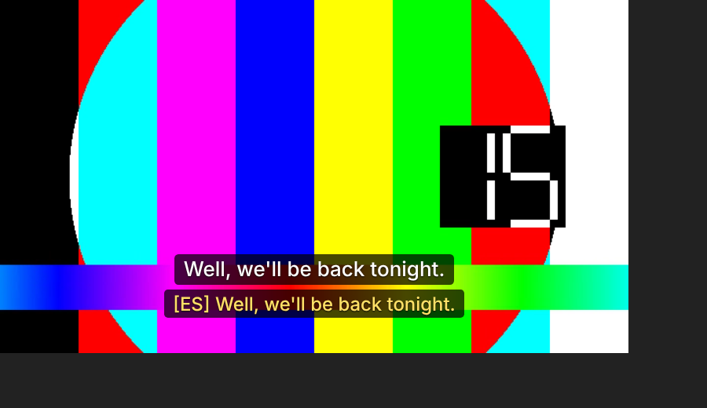

# Dual Subtitles

A Chrome extension (Manifest V3, also works in Edge, Brave and Opera) that shows subtitles in **two languages at once**: the language the video was made in, with your own language underneath.

It uses the site's own subtitles on **YouTube**, **Netflix**, **Prime Video** (primevideo.com and Prime Video on amazon.com, .co.uk, .de, .co.jp, .ca, .fr, .it, .es, .in, .com.au, .com.br, .com.mx, .nl) and **Disney+**.

For a video with no subtitles, or on **any other website**, it can **generate subtitles from the audio**. Speech recognition runs on your computer with OpenAI's Whisper model, so the audio never leaves the browser.

It's free. Payments were built and then removed; see [Adding payments later](#adding-payments-later).

 

Subtitles generated from the audio:



## How it works

| Site | Where the subtitles come from | Your language |
| --- | --- | --- |
| YouTube | The player's caption tracks. The extension reuses the signed `timedtext` request the player makes, so captions are turned on briefly in the background. The original language comes from the auto-generated track, which is always in the spoken language. | A human-made track in your language if the video has one, otherwise YouTube's own auto-translate (`tlang`). |
| Netflix | The title manifest, captured in the page. The extension also asks Netflix to include WebVTT files. The original language is the audio track Netflix marks as native. | Netflix's track in your language. If there isn't one, the original track is machine-translated. |
| Prime Video | The `GetPlaybackResources` response, which lists a TTML file per language. | Prime's track in your language. If there isn't one, the original track is machine-translated. |
| Disney+ | The HLS master playlist, which lists a subtitle rendition per language. Each rendition is a playlist of short WebVTT segments, which are downloaded and joined. The original language comes from the title's metadata (`originalLanguage`). | Disney+'s track in your language. If there isn't one, the original track is machine-translated. |
| Any site, or a video without subtitles | Generated from the tab's audio (see below). | Machine translation of each line. |

Both lines are drawn in one overlay that follows the video, including in fullscreen. By default the site's own subtitles are hidden so you don't see three lines. In the popup you can set your language, override the original language, change text size and position, flip which line is on top, and shift the timing.

### Subtitles from the audio

Click the extension icon and press **Listen to this tab**, or press **Alt+Shift+S** (change it at `chrome://extensions/shortcuts`). Chrome only allows tab audio capture after you invoke the extension on that tab, so this can't start by itself.

1. `chrome.tabCapture` hands the tab's audio to an offscreen document (`offscreen.html`). The audio keeps playing through your speakers.
2. A 16 kHz copy goes through a small voice-activity segmenter (`lib/segmenter.js`). It cuts the audio at pauses, or every 6 seconds during continuous speech, and drops silence.
3. Each chunk is transcribed with Whisper through [Transformers.js](https://github.com/huggingface/transformers.js) and ONNX Runtime Web. It uses WebGPU when available and WebAssembly otherwise.
4. The spoken language is detected from the first three chunks, then fixed. You can also set **Original language** in the popup.
5. Each line is shown as soon as it's transcribed, which is a second or two after it's spoken, and is translated into your language.

The popup offers three model sizes: **Fast** (`whisper-tiny`), **Balanced** (`whisper-base`, the default) and **Accurate** (`whisper-small`). The model is downloaded from Hugging Face the first time and cached by the browser. To serve it from your own server instead, set `asrModelHost` in `chrome.storage.sync`; models are read from `{asrModelHost}/{model}/resolve/main/`.

Limits of this mode:
- The lines lag the speech slightly and can't be matched exactly to the video's timeline.
- Accuracy depends on the model size, background music and how clearly people speak.
- Not yet tried against the live streaming sites. If a site blocked audio capture during DRM playback, this mode wouldn't work there. The site's own subtitles would still work on the four supported sites.

### Code layout

```
src/
  manifest.json
  config.js            Optional translation API key
  background.js        Subtitle downloads, machine translation, tab-audio sessions
  page-hook.js         Runs in the page (MAIN world): watches the players' own requests
  content.js           Loads both tracks or live lines, renders the overlay
  adapters/            One file per site: youtube.js, netflix.js, prime.js, disney.js
  lib/subs.js          Parsers (YouTube json3, WebVTT, TTML/DFXP, HLS playlists), cue lookup, track picking
  lib/segmenter.js     Splits audio into speech chunks; filters Whisper's typical false lines
  offscreen.html/.js   Tab-audio capture + Whisper speech recognition
  audio-worklet.js     Taps the captured audio at 16 kHz
  vendor/transformers/ Transformers.js 4.3.1 (Apache-2.0) and ONNX Runtime Web (MIT), fetched by npm run vendor
scripts/vendor.js      Downloads the files above
  popup.html/.js/.css  Settings and the Listen button
  welcome.html         Opens on install
test/                  Unit tests: npm test
```

To support another site, add a file to `src/adapters/` with `match`, `init`, `currentKey` and `resolve` (copy `netflix.js` as a starting point), then add its URL patterns to `manifest.json`.

## Try it locally

1. Run `npm run vendor` once. It downloads the speech-recognition runtime (Transformers.js and ONNX Runtime Web, pinned versions) into `src/vendor/`. It isn't kept in git because it's third-party code and includes a 27 MB binary.
2. Open `chrome://extensions` and turn on **Developer mode**.
3. Click **Load unpacked** and pick the `src/` folder.
4. Open a YouTube video that has subtitles.

### Machine translation

On YouTube, translation is free because it uses YouTube's own auto-translate. On Netflix, Prime Video and Disney+ it's only needed when the title has no subtitle track in the viewer's language. Subtitles generated from audio are always translated line by line.

- **Before you publish to many users**, put a [Google Cloud Translation](https://cloud.google.com/translate) API key in `googleTranslateApiKey` in `src/config.js`. It costs about $20 per million characters, which is roughly 25–40 feature-length films.
- If you leave it empty, the extension uses Google's keyless `translate_a` endpoint. That's fine for development, but it isn't an official API and can be rate-limited.

## Publish

1. `npm run zip` downloads the speech-recognition runtime if needed and creates `dual-subtitles.zip` from `src/`.
2. Upload it in the [Chrome Web Store developer dashboard](https://chrome.google.com/webstore/devconsole) (one-time $5 fee). Use the screenshots in `docs/`.
3. In the listing, explain each permission:
   - site access to read subtitles on YouTube, Netflix, Prime Video and Disney+, and their subtitle CDNs (`nflxvideo.net`, `cloudfront.net`, `media-amazon.com`, `dssott.com`, `bamgrid.com`);
   - `tabCapture`, `offscreen`, `activeTab` and `scripting` for subtitles generated from audio;
   - Hugging Face, to download the speech model;
   - Google translation.

   The zip is about 30 MB because it includes the speech-recognition runtime.
4. Edge Add-ons accepts the same zip.

## Limitations

- Netflix and Prime Video change their players often. If subtitles stop appearing on one site, that site's adapter in `src/adapters/` is the place to fix it.
- Netflix and Disney+: reload the tab if you open a title in a tab that was already open before the extension was installed.
- Disney+ HLS subtitle segments sometimes carry a timestamp offset. If lines are early or late, use **Timing offset**.
- Prime Video sometimes starts the video timeline a few seconds off. Fix it with **Timing offset** in the popup.
- Not tested yet against the live Netflix, Prime Video and Disney+ sites. The end-to-end check ran the real extension in Chromium against simulated pages and API responses (see below).

## Tests

```
npm test
```

Unit tests cover:
- the subtitle parsers: YouTube json3, WebVTT, and TTML/DFXP with ticks, clock times, line breaks and split regions;
- HLS master and media playlists, and joining segments without duplicate lines;
- cue lookup and choosing the original and viewer-language tracks;
- the speech segmenter and transcript filter.

During development the extension was also loaded unpacked in Chromium against simulated YouTube, Netflix, Prime Video and Disney+ pages. That check confirmed:
- both subtitle lines appear on all four sites, including Disney+'s shadow-DOM player;
- the site's own captions are hidden;
- machine translation runs when a title has no track in the viewer's language.

The audio path was tested with recorded synthetic speech fed into the offscreen page and a real Whisper model (`whisper-tiny`, served locally). The lines reached the overlay on a YouTube video without captions, with the language detected and the lines translated. The `chrome.tabCapture` step needs a real click on the extension, so it can only be tried in a normal browser.

## Adding payments later

A version with a paywall was written and tested, then removed so the extension can ship free. It's in git commit `ba5f392` ("Add Dual Subtitles browser extension"). It used [ExtensionPay](https://extensionpay.com), which runs on Stripe, and had:

- a 1-month free trial tied to the user's email, so reinstalling doesn't reset it;
- a subscription priced in the ExtensionPay dashboard;
- a "Subscribe" prompt on the video page and in the popup once the trial ends;
- a login for paying users on other browsers.

To bring it back, run `git show ba5f392 -- dual-subtitles/src` to see the paid files, or ask for the paywall to be re-applied on top of the current code. Existing free users would then need a grace period or a trial of their own.
