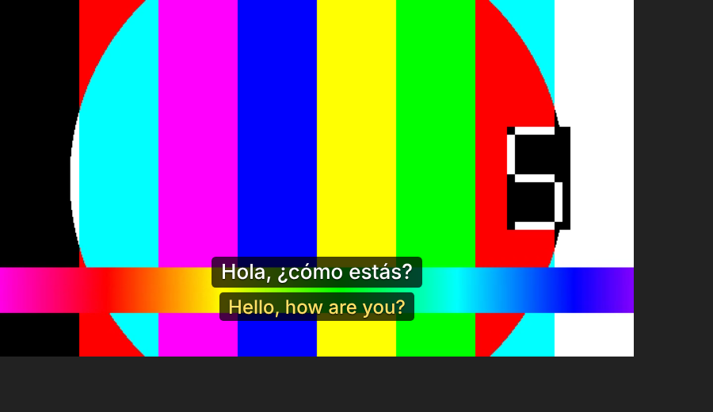
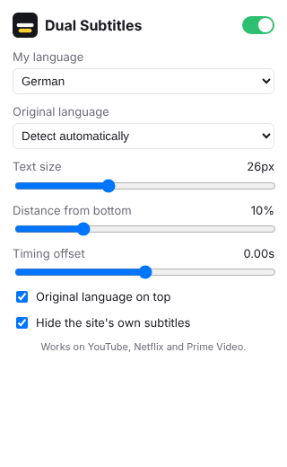

# Dual Subtitles

A Chrome extension (Manifest V3, also works in Edge, Brave and Opera) that shows subtitles in **two languages at once**: the language the video was made in, with your own language underneath.

Works on **YouTube**, **Netflix** and **Prime Video** (primevideo.com and Prime Video on amazon.com, .co.uk, .de, .co.jp, .ca, .fr, .it, .es, .in, .com.au, .com.br, .com.mx, .nl).

It's free. Payments were built and then removed; see [Adding payments later](#adding-payments-later).

 

## How it works

| Site | Where the subtitles come from | Your language |
| --- | --- | --- |
| YouTube | The player's caption tracks. The extension reuses the signed `timedtext` request the player makes, so captions are turned on briefly in the background. The original language comes from the auto-generated track, which is always in the spoken language. | A human-made track in your language if the video has one, otherwise YouTube's own auto-translate (`tlang`). |
| Netflix | The title manifest, captured in the page. The extension also asks Netflix to include WebVTT files. The original language is the audio track Netflix marks as native. | Netflix's track in your language. If there isn't one, the original track is machine-translated. |
| Prime Video | The `GetPlaybackResources` response, which lists a TTML file per language. | Prime's track in your language. If there isn't one, the original track is machine-translated. |

Both lines are drawn in one overlay that follows the video, including in fullscreen. By default the site's own subtitles are hidden so you don't see three lines. In the popup you can set your language, override the original language, change text size and position, flip which line is on top, and shift the timing.

### Code layout

```
src/
  manifest.json
  config.js            Optional translation API key
  background.js        Subtitle downloads, machine translation
  page-hook.js         Runs in the page (MAIN world): watches the players' own requests
  content.js           Loads both tracks, renders the overlay
  adapters/            One file per site: youtube.js, netflix.js, prime.js
  lib/subs.js          Parsers (YouTube json3, WebVTT, TTML/DFXP), cue lookup, track picking
  popup.html/.js/.css  Settings and account
  welcome.html         Opens on install
test/                  Unit tests: npm test
```

To support another site, add a file to `src/adapters/` with `match`, `init`, `currentKey` and `resolve` (copy `netflix.js` as a starting point), then add its URL patterns to `manifest.json`.

## Try it locally

1. Open `chrome://extensions` and turn on **Developer mode**.
2. Click **Load unpacked** and pick the `src/` folder.
3. Open a YouTube video that has subtitles.

### Machine translation

On YouTube, translation is free because it uses YouTube's own auto-translate. On Netflix and Prime Video it's only needed when the title has no subtitle track in the viewer's language.

- **Before you publish to many users**, put a [Google Cloud Translation](https://cloud.google.com/translate) API key in `googleTranslateApiKey` in `src/config.js`. It costs about $20 per million characters, which is roughly 25–40 feature-length films.
- If you leave it empty, the extension uses Google's keyless `translate_a` endpoint. That's fine for development, but it isn't an official API and can be rate-limited.

## Publish

1. `npm run zip` creates `dual-subtitles.zip` from `src/`.
2. Upload it in the [Chrome Web Store developer dashboard](https://chrome.google.com/webstore/devconsole) (one-time $5 fee). Use the screenshots in `docs/`.
3. In the listing, explain each permission: site access to read subtitles on YouTube, Netflix and Prime Video; the subtitle CDNs (`nflxvideo.net`, `cloudfront.net`, `media-amazon.com`); and Google translation.
4. Edge Add-ons accepts the same zip.

## Limitations

- Netflix and Prime Video change their players often. If subtitles stop appearing on one site, that site's adapter in `src/adapters/` is the place to fix it.
- Netflix: reload the tab if you open a title in a tab that was already open before the extension was installed.
- Prime Video sometimes starts the video timeline a few seconds off. Fix it with **Timing offset** in the popup.
- Not tested yet against the live Netflix and Prime Video sites. The end-to-end check ran the real extension in Chromium against simulated YouTube, Netflix and Prime pages and API responses (see below).

## Tests

```
npm test
```

Unit tests cover the subtitle parsers (YouTube json3, WebVTT, TTML/DFXP with ticks, clock times, line breaks and split regions), cue lookup, and choosing the original and viewer-language tracks.

During development the extension was also loaded unpacked in Chromium against simulated YouTube, Netflix and Prime Video pages. That check confirmed that both subtitle lines appear on all three sites, the site's own captions are hidden, and machine translation runs when a title has no track in the viewer's language.

## Adding payments later

A version with a paywall was written and tested, then removed so the extension can ship free. It's in git commit `ba5f392` ("Add Dual Subtitles browser extension"). It used [ExtensionPay](https://extensionpay.com), which runs on Stripe, and had:

- a 1-month free trial tied to the user's email, so reinstalling doesn't reset it;
- a subscription priced in the ExtensionPay dashboard;
- a "Subscribe" prompt on the video page and in the popup once the trial ends;
- a login for paying users on other browsers.

To bring it back, run `git show ba5f392 -- dual-subtitles/src` to see the paid files, or ask for the paywall to be re-applied on top of the current code. Existing free users would then need a grace period or a trial of their own.
