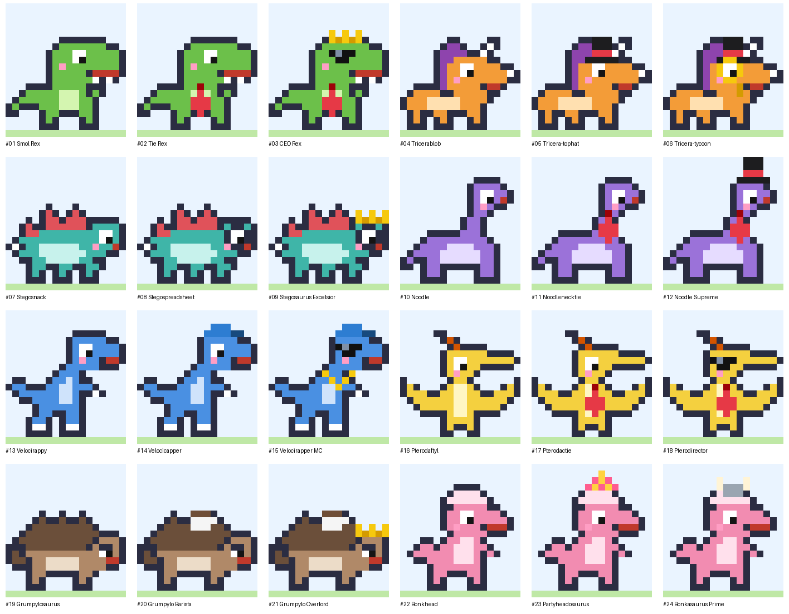
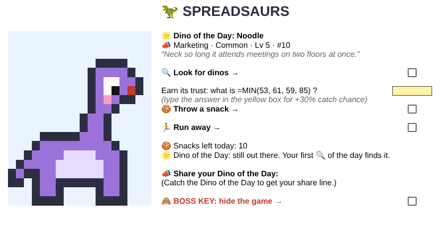

# 🦖 Spreadsaurs

**The dinosaur-collecting game you can play at work, because it looks like a spreadsheet.**

Spreadsaurs runs entirely inside Google Sheets. You catch funny office dinosaurs drawn as pixel art in the cells, fill your Dex, evolve them, trade them with friends using short codes, and battle other people's teams. One click on the boss key hides it all behind a boring FY25 budget.



## Set it up (about 2 minutes)

1. Create a blank Google Sheet.
2. Open **Extensions → Apps Script**. Delete the sample code, paste the whole of [`Code.gs`](Code.gs), and click **Save**.
3. Choose `setupSpreadsaurs` in the function dropdown at the top and click **Run**. Google will ask you to approve permissions; the script only touches this one spreadsheet.
4. Go back to the sheet. You'll see five tabs, and a **🦖 Spreadsaurs** menu appears the next time the sheet opens.

Every checkbox acts as a button: tick it and the action runs.



## How to play

| Tab | What it does |
|---|---|
| **FY25 Budget** | The decoy. Opens first, looks like real work. Tick **Reconciled** to bring the game back. |
| **🦖 Encounter** | 🔍 Look for dinos, 🍪 throw snacks to catch them, 🏃 run away, 🙈 boss key. |
| **Collection** | Every dino you own, with stats. Rename them, tick **Team ⚔️** to choose your battle team, tick **Send ✉️** to trade one away, tick 🧬 **Evolve** to merge 3 identical dinos into the next stage. |
| **Dex** | All 24 species. Uncaught ones show as silhouettes. |
| **Trade & Battle** | Redeem friends' DINO codes, make your TEAM code, battle friends and fight the Daily Boss. |

**Daily loop**

- **🌟 Dino of the Day:** your first 🔍 each day finds the same dino that every player in the world sees that day (it switches at midnight UTC). It never runs away. Catch it to get a share line, Wordle-style:
  `🦖 SPREADSAURS 2026-10-15 · Dino of the Day: CEO Rex ✨ · caught with 🍪🍪 · Dex 7/24`
- **🍪 10 snacks per day.** Each throw costs one. Answer the little formula quiz (like `=MAX(53, 61, 59, 85)`) in the yellow box for +30% catch chance.
- **✨ Shinies:** wild dinos have a 1 in 64 chance of being shiny (a different color scheme). About one day in 16, the Dino of the Day itself is shiny.
- **👔 Daily Boss, The Auditor:** beat today's boss team for +5 snacks and +1 level for your team.

**Evolution:** each species has 3 stages. Collect 3 of the same species and tick 🧬 Evolve. The new dino keeps the best stats of the three, the highest level, and shininess if any of them was shiny.

**Departments (types):** 📈 Finance beats 📣 Marketing, which beats 💻 IT, which beats 🧾 HR, which beats 📈 Finance. Attacks on the type you beat do 1.5× damage.

**Trading:** ticking **Send ✉️** removes the dino from your Collection and gives you a code like `DINO-7F3K-QX2M-9A`. Whoever redeems it first gets the dino. Each code works once per sheet.

**Battling:** share your TEAM code anywhere. When two people battle each other's codes on the same day, both see the exact same fight and result. Winning gives your team +1 level (once per opponent per day).

## The 24 species

| Line | Dept | Stage 1 | Stage 2 | Stage 3 |
|---|---|---|---|---|
| T. rex | 📈 Finance | Smol Rex | Tie Rex | CEO Rex |
| Triceratops | 🧾 HR | Tricerablob | Tricera-tophat | Tricera-tycoon |
| Stegosaurus | 💻 IT | Stegosnack | Stegospreadsheet | Stegosaurus Excelsior |
| Long-neck | 📣 Marketing | Noodle | Noodlenecktie | Noodle Supreme |
| Raptor | 📣 Marketing | Velocirappy | Velocicapper | Velocirapper MC |
| Pterodactyl | 📈 Finance | Pterodaftyl | Pterodactie | Pterodirector |
| Ankylosaurus | 💻 IT | Grumpylosaurus | Grumpylo Barista | Grumpylo Overlord |
| Pachycephalosaurus | 🧾 HR | Bonkhead | Partyheadosaurus | Bonkasaurus Prime |

Shiny versions: see [`preview-shiny.png`](preview-shiny.png).

## Known limits

- Codes are checksummed to catch typos, not to stop cheating. Anyone who reads the script can forge them.
- Everything is stored inside your own copy of the sheet (in a hidden `_state` tab). Deleting that tab resets your progress.
- Google runs the checkbox actions as "simple triggers", which have a 30-second limit. Normal play takes 1–2 seconds per action.

## Development

The game logic is plain JavaScript, so it can be tested in Node with a small mock of the Sheets API:

```bash
node tools/test.js                                                 # 20 end-to-end tests
node tools/dump_sprites.js | python3 tools/render_preview.py preview.png          # regenerate the Dex preview
node tools/dump_sprites.js | python3 tools/render_preview.py preview-shiny.png shiny
```

To add a species line, add a body to `BODIES` (18 characters wide) and an entry to `LINES`, then raise `SPECIES_COUNT`. Trade codes support up to 32 species.
